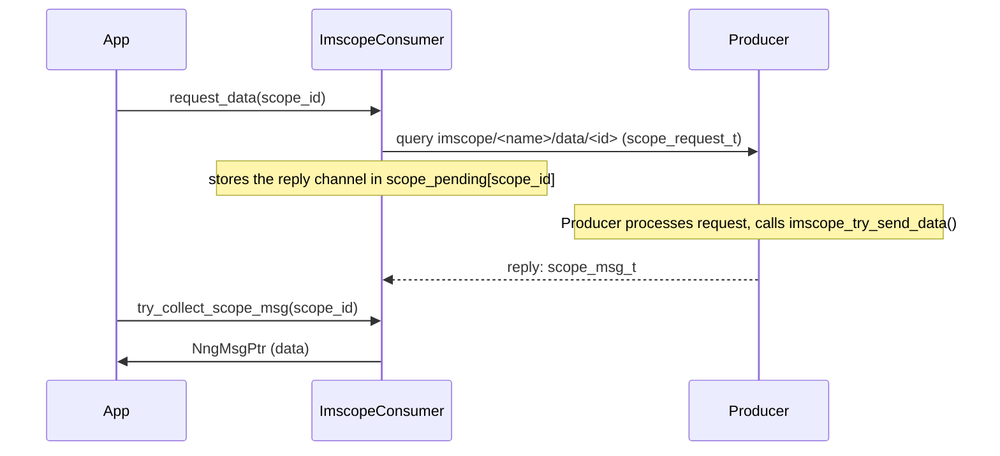

# imscope_consumer Analysis and Description

The `imscope_consumer` is the client-side component of the `imscope` project, responsible for discovering producers and requesting data through a high-performance communication layer based on **Zenoh** (Eclipse zenoh), using the official `zenoh-cpp`/`zenoh-c` bindings.

## Architecture and Discovery Process

The consumer acts as the **querier**: it sends a `Query` and the producer (the **queryable**) replies to it on-demand, ensuring that it only receives data when it's ready to process it.

### Discovery Phase

Before data can be requested, the consumer must discover the producer's configuration:

1.  **Open a Session**: The consumer opens a Zenoh `Session` (optionally connecting to an explicit locator; otherwise relying on default scouting/discovery).
2.  **Request Info**: It queries `imscope/<name>/announce` with an `announce_request_t` and waits for an `announce_response_t` reply.
3.  **Configure Consumer**: The response contains the producer's name and the list of available scopes.
4.  **Initialize**: A new `ImscopeConsumer` instance is created with this configuration, taking ownership of the session.

### Data Collection Flow



## Key Components

- **`ImscopeConsumer` (Main Class)**:
    - Owns the Zenoh `Session` and manages the discovery process.
    - Provides a high-level API for requesting and collecting data.
    - Holds one `std::optional<zenoh::channels::FifoHandler<zenoh::Reply>>` per configured scope (`scope_pending`) — the reply channel for that scope's in-flight `get()` call while a `request_data()` is outstanding, the direct analog of the old NNG version's per-scope `nng_ctx`/`nng_aio` pair. Empty when no request is outstanding.
- **`NngMsgPtr` (Memory Management)**:
    - A `std::shared_ptr<void>`, kept under this name for source compatibility with existing call sites.
    - No longer backed by an `nng_msg`: the pointee is now a heap-allocated `std::vector<uint8_t>` built from a Zenoh reply payload, kept alive via the shared_ptr's aliasing constructor.

## API and Usage

### Connecting to a Producer

```cpp
ImscopeConsumer* consumer = ImscopeConsumer::connect("My Producer");
// Or with an explicit locator instead of default scouting:
ImscopeConsumer* consumer = ImscopeConsumer::connect("My Producer", "tcp/127.0.0.1:7447");
```
`name` is the producer's name (the `imscope/<name>/...` key-expression prefix) — this replaces the old NNG `announce_address` URL. Queries the announce key expression and returns a configured consumer instance.

### Requesting and Collecting Data

```cpp
// 1. Request data for a specific scope
consumer->request_data(0);

// 2. Poll for the data message
int version = 0;
NngMsgPtr msg_ptr = consumer->try_collect_scope_msg(0, version);

if (msg_ptr) {
    scope_msg_t* msg = static_cast<scope_msg_t*>(msg_ptr.get());
    // Process data...
}
```

### High-Level Helpers

The consumer also provides helpers for processing common data types:
- **`try_collect_iq`**: Pulls data and converts it into real/imaginary parts (`std::vector<int16_t>`).
- **`try_collect_real`**: Pulls data and converts it into a single real vector.

## Threading and Synchronization

- **Asynchronous Operations**: `request_data()` fires a Zenoh `get()` and returns immediately (replies arrive asynchronously via Zenoh's own runtime into a `FifoHandler` channel); `try_collect_scope_msg()` polls that channel non-blockingly, mirroring the old NNG version's `nng_aio_result(...) == -1` "still in flight" check.
- **Parallel Requests**: Since each scope has its own pending-reply slot, the consumer can handle requests for different scopes concurrently over the same `Session`.
- **Thread Safety**: The consumer is designed to be used in a single-threaded loop or with a polling mechanism. If shared across threads, external synchronization may be required (`scopes_mutex` protects `configured_scopes`, but `scope_pending` polling itself is not designed for concurrent access from multiple threads on the same scope).
