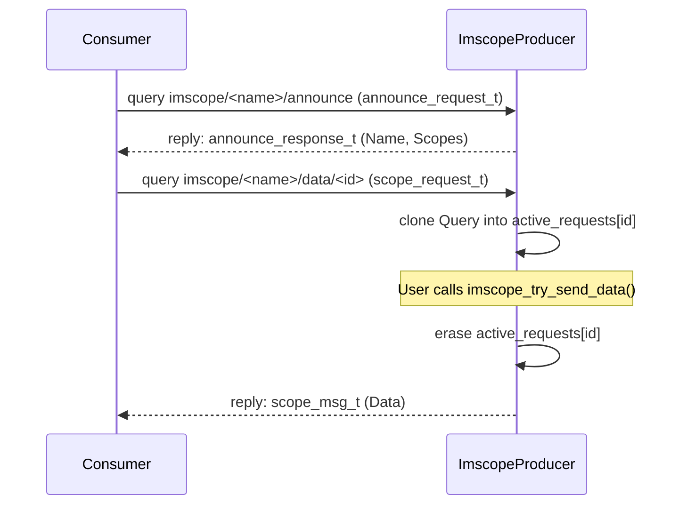

# imscope_producer Analysis and Description

The `imscope_producer` is a core component of the `imscope` project, responsible for providing data to consumers through a high-performance communication layer based on **Zenoh** (Eclipse zenoh), using the official `zenoh-cpp`/`zenoh-c` bindings built from Zenoh's Rust reference implementation.

## Architecture and Design

The producer is designed around a **query/reply** pattern, where the consumer sends a `Query` (the "requestor") asking for data, and the producer replies to it (the "replier") when data becomes available. This "pull-on-demand" model ensures that consumers only receive data when they are ready to process it, preventing buffer overflows and flow control issues.

### Key Components

- **`ImscopeProducer` (Main Class)**:
    - Orchestrates the entire lifecycle: initialization, scope configuration, Zenoh session management, and cleanup.
    - Opens a single Zenoh `Session` and declares a `Queryable` each for the announce and control key expressions, plus one per scope for data (`imscope/<name>/announce`, `imscope/<name>/control`, `imscope/<name>/data/<scope_id>`).
    - Manages an internal `active_requests` map (`std::unordered_map<int, zenoh::Query>`, guarded by `active_requests_mutex`) tracking which scopes currently have a consumer `Query` waiting to be answered.

### Data Flow

A scope's `Queryable` callback, on a valid `scope_request_t`, clones the incoming `Query` and stores it in `active_requests` under that scope's id — it does not reply yet. A later call to `imscope_try_send_data` (or the buffered/`by_name`/`by_group` variants) looks up and erases that entry and calls `query.reply(...)` with the encoded `scope_msg_t`. If nothing is pending for that scope id, the call returns `IMSCOPE_ERROR_BUSY` immediately — no blocking, and the frame is simply dropped.



## API and Usage

The producer provides a C-compatible API for easy integration with other languages and legacy systems.

### Initialization and Configuration

```c
imscope_return_t imscope_init_producer(const char* data_address,
                                      const char* announce_address,
                                      const char* name,
                                      imscope_scope_desc_t* scopes,
                                      size_t num_scopes);
```
`name` is how consumers find this producer (the `imscope/<name>/...` key-expression prefix). `announce_address` is now an optional Zenoh locator to explicitly connect to (e.g. `"tcp/127.0.0.1:7447"`); an empty string relies on Zenoh's default scouting/discovery. `data_address` is unused/deprecated, kept only for source compatibility with existing call sites.

### Sending Data

There are two primary ways to send data:

1.  **Immediate Send (`imscope_try_send_data`)**:
    Copies data from a user-provided buffer, encodes it as a `scope_msg_t`, and replies to the pending `Query` immediately if one exists for that scope.
2.  **Zero-Copy / Buffered Send**:
    - **`imscope_acquire_send_buffer`**: Returns a pointer to a pre-allocated buffer for the caller to write sample data into directly.
    - **`imscope_commit_send_buffer`**: Commits the buffer and replies to the pending `Query`, exactly as `imscope_try_send_data` does.

## Threading and Synchronization

- **Zenoh callbacks**: `Queryable` callbacks run on Zenoh's own runtime threads; they never block the producer's main execution loop.
- **Mutex Protection**: A `std::mutex` (`active_requests_mutex`) protects the `active_requests` map, which is accessed by both the Zenoh callback threads and the user-facing `imscope_try_send_*`/buffer API.
- **Atomic Operations**: `std::atomic` flags are used for signaling thread termination and tracking request states.
